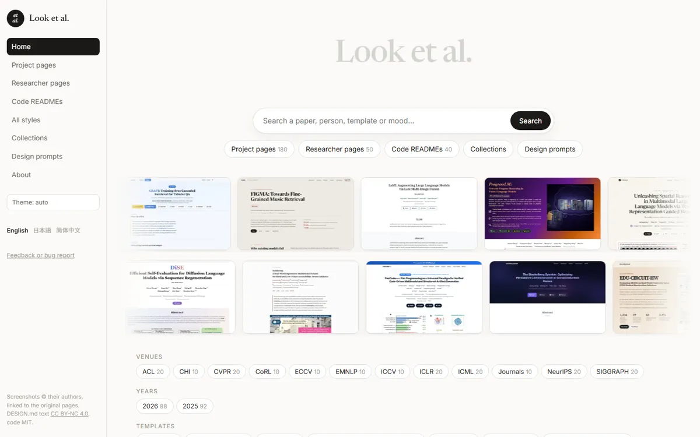
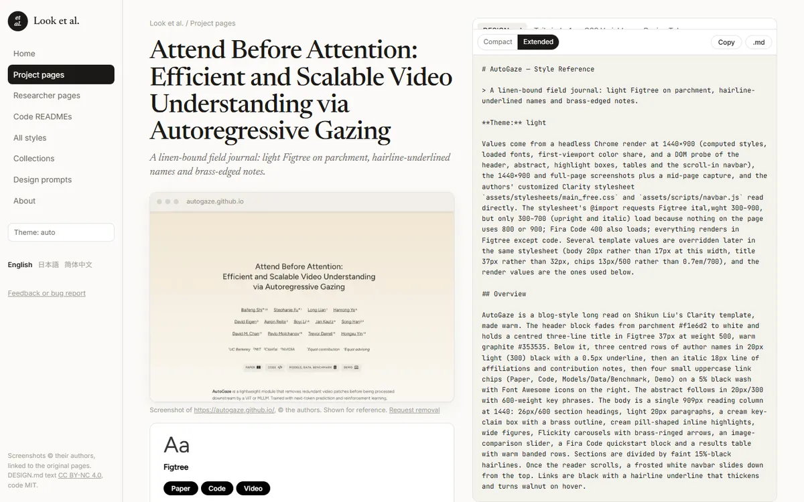
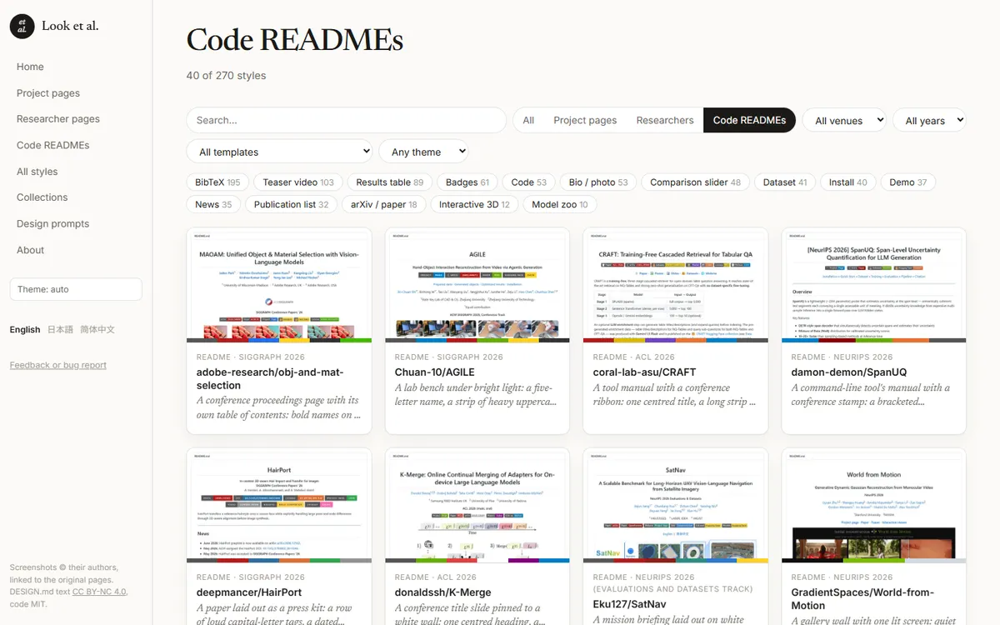

<div align="center">

# Look et al.

**A design library of academic web pages for humans and AI agents.**

Paper project pages, researcher homepages and code READMEs, each with an AI-readable DESIGN.md.

[](https://looketal.com/)
[](https://doi.org/10.5281/zenodo.23718470)
[](LICENSE-CONTENT.md)
[](LICENSE)

[English](https://looketal.com/) · [日本語](https://looketal.com/ja/) · [简体中文](https://looketal.com/zh/)

<a href="https://looketal.com/"></a>

</div>

## What is in it

| | Entries | Picked from |
|---|---:|---|
| Paper project pages | 180 | 907 pages from NeurIPS, ICML, ICLR, CVPR, ACL, ICCV, ECCV, SIGGRAPH, CoRL, CHI, EMNLP and journals, 2025–2026 |
| Researcher homepages | 50 | 236 researchers found by fixed rules (awards, prizes, keynotes) |
| Code READMEs | 40 | 647 official repositories linked from the project pages |

Every entry has a screenshot, the reason it was picked, and a DESIGN.md that records its palette, type, spacing, components and page modules, measured from the rendered page.

<table>
<tr>
<td width="50%"><a href="https://looketal.com/s/cvpr-2026-autogaze.html"></a></td>
<td width="50%"><a href="https://looketal.com/browse.html?kind=readme"></a></td>
</tr>
<tr>
<td align="center">Style page with its DESIGN.md</td>
<td align="center">Browse by venue, year, template and page module</td>
</tr>
</table>

## Use a DESIGN.md

1. Find a page you like on [looketal.com](https://looketal.com/) and copy its DESIGN.md (or download the `.md`).
2. Give it to your coding agent together with your own content, for example:

```text
Build a project page for our paper "[title]" ([venue]). Use the attached DESIGN.md for colors, type, spacing and component styling only.
Content comes from our paper: authors and affiliations, [teaser figure or video], abstract, [method figure], [results], BibTeX.
Link buttons: [Paper] [arXiv] [Code] [Data] [Demo].
Keep it a static page that works on GitHub Pages. List which visual decisions came from the reference and which you changed.
```

More prompts, including researcher homepages and READMEs, are on the [Design prompts](https://looketal.com/prompts.html) page.

## Feedback and removal

Found a wrong value, a broken link or a site bug? [Open an issue](https://github.com/dengzhe-hou/looketal/issues/new) (every page on the site has a Feedback link). Authors can ask for removal or correction through [this form](https://github.com/dengzhe-hou/looketal/issues/new?template=removal.yml).

## How entries were chosen

- **Project pages.** Pool of 907 (NeurIPS, ICML, ICLR, CVPR, ACL 2025 and 2026; ICCV 2025, ECCV 2026, SIGGRAPH 2025 and 2026, CoRL 2025, CHI 2026, EMNLP 2025; TMLR, TPAMI, JMLR and Nature-family journals 2025–2026; arXiv comments that state acceptance and link a project page; workshops excluded). 10 per venue-year, plus 10 journal papers.
- **Researcher homepages.** Pool of 236 by three fixed rules (ACM Turing laureates 2018–2025 and first or last authors of Best, Outstanding and Test of Time papers at NeurIPS, ICML, ICLR, CVPR and ACL 2023–2025; first and last authors of ACL Outstanding Papers 2023–2025; Rumelhart Prize 2010–2025, Glushko Prize 2018–2025, CogSci Computational Modeling Prize 2020–2025 and CCN keynote speakers 2023–2025). 30 + 10 + 10 selected.
- **Code READMEs.** The official repositories linked from the project-page pool (647 with a README of at least 2.5 KB), in four groups (vision, learning, language, graphics/robotics/HCI); 10 per group.
- **Selection** is by visual design only, from screenshots, in two rounds. The reason for each pick is in `data/catalog.json` and on the style page.
- **DESIGN.md files** are written from the rendered page ([`content/METHOD.md`](content/METHOD.md)) or, for READMEs, from the Markdown and GitHub's rendering ([`content/METHOD_README.md`](content/METHOD_README.md)). Tests are in [`content/TESTS.md`](content/TESTS.md). DESIGN.md files stay in English so that people and coding agents read one text; the site interface is in English, Japanese and Simplified Chinese.

<details>
<summary><b>Repository layout, build and site structure</b></summary>

| Path | What it is |
|---|---|
| `content/designs/*.md` | One DESIGN.md per page (source of truth) |
| `data/catalog.json` | One record per included page (build input) |
| `data/raw/` | Candidate pool and collection records |
| `content/shots/` | Screenshots (1200×750 and 640×400 webp) |
| `content/archive/v1/` | First-version DESIGN.md files, kept for comparison |
| `data/entries.json` | Normalized entry list, written by the build |
| `tools/computed_style.py` | Reads computed styles, loaded fonts and first-viewport anatomy from the rendered page (headless Chrome) |
| `tools/snap.py` | Screenshots |
| `tools/lint_design.py` | Structure and color-consistency check for DESIGN.md files |
| `tools/check_links.py` | Link check (run weekly by a GitHub Action) |
| `tools/extract_style.py` | Declaration counts from a page's static HTML and linked CSS |
| `tools/readme_pool.py` | Finds the code repository linked from each project page and keeps READMEs of at least 2.5 KB |
| `tools/readme_render.py` | Renders a README with GitHub's own HTML for screenshots and writers |
| `tools/build_site.py` | Builds the static site into `docs/` (English at the root, Japanese in `ja/`, Chinese in `zh/`) |
| `tools/i18n.py`, `tools/i18n_about.py` | Site text in English, Japanese and Simplified Chinese |
| `data/i18n/` | Japanese and Chinese mood lines and selection reasons per entry |
| `tools/assets/` | Site CSS and JS |
| `docs/` | Generated site (GitHub Pages ready) |

```bash
python -I -B tools/build_site.py
python -I -B -m http.server 8765 --directory docs
```

- **Home**: search plus browse by venue, year, template, page module and field.
- **Browse**: filterable grid; filters live in the URL (`browse.html?conf=CVPR&module=BibTeX`).
- **Style page** (`s/<slug>.html`): specimen, palette, type samples, spacing, page modules, guidelines, similar pages; side panel with DESIGN.md (compact / extended), Tailwind v4, CSS variables and design tokens.
- **Collections**: rule-based groups with a short "look closer" note.
- **Design prompts**: prompt templates for building a page from a DESIGN.md.
- **About**: inclusion rules, method, removal policy.

</details>

## License and citation

Code (`tools/`, `.github/`) is MIT ([`LICENSE`](LICENSE)). DESIGN.md files, the selection, `data/` and site text are CC BY-NC 4.0 ([`LICENSE-CONTENT.md`](LICENSE-CONTENT.md)). Screenshots belong to the pages' authors and are covered by neither; each one on the site is credited and linked to the live page.

```text
Hou, D. (2026). Look et al.: A Design Library of Academic Web Pages for Humans and AI Agents. Zenodo. https://doi.org/10.5281/zenodo.23718470
```

This DOI always points to the latest version; metadata is in `CITATION.cff`.
