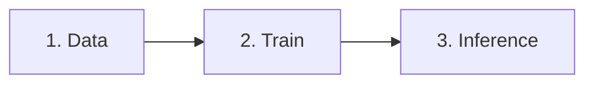

# LatSearch — README Reference

> A quiet title card followed by a storyboard: each prompt gets a strip of frames from the base model and a red-framed strip from the method, so the difference is read before a word of method is.

**Theme:** light

Read from `README.md` on the default branch `main` of github.com/zengqunzhao/LatSearch (last commit touching the file 8e7d31e, 2026-09-02; captured 2026-10-28). Evidence is the raw Markdown, the HTML that GitHub's API returns for it, a 1440×900 first-screen capture and a 2700px tall capture of the light theme, with the README column 920px wide (856px content width). Badge colors come from the SVGs that shields.io returns for each badge URL; image sizes come from the PNG headers fetched from the repo, and teaser colors from pixel counts on `fig_videos_comparison.png`. GitHub sets the type (its system stack, Segoe UI in the Windows captures), the 16px body size and the heading rules; nothing in the README overrides them.

## Overview

The header is written almost entirely in Markdown inside a `<div align="center">`, which gives it a calm, even rhythm: a `#` title with GitHub's rule, a `###` subtitle without one, two lines of plain-text author names joined by middle dots, one affiliation line, four small flat badges (venue, arXiv, project page, license), a bold "Accepted at ECCV 2026" line, and a full-width teaser. The teaser is a grid of three prompts; each prompt has a bold prompt line with key words in red, a row of six frames from "Wan 1.3B" and a row from "Wan 1.3B + LatSearch" outlined in a red frame, on pale per-prompt background bands. Below the header, eleven plain `##` sections without emoji walk from Overview and Method through a Results section that pairs the paper's full results figure with a short Markdown table, then Installation, Quick Start, baselines, a Mermaid training-pipeline flowchart, the repository layout, Citation, Acknowledgements and License. Code blocks are many and long, all language-tagged.

## Header Block

Rendered positions are y values in the 1440×900 capture (the README box starts at y≈25 with its "README.md" file bar; content starts at y≈80). Blank lines between every element inside `<div align="center">` let GitHub parse the contents as Markdown, so each line becomes its own centred paragraph or heading.

1. **Title** (y≈139): `# LatSearch`. GitHub h1, 2em (32px), weight 600, with the 1px grey rule across the 856px content width.
2. **Subtitle** (y≈206): `### Latent Reward-Guided Search for Faster Inference-Time Scaling in Video Diffusion`. GitHub h3, 1.25em (20px), weight 600, no rule; one line at this width.
3. **Authors** (y≈246 and 270): plain text, names joined by ` · `, broken after the fifth name with `<br>`. No links, no superscripts and no affiliation marks.
4. **Affiliations** (y≈310): `Queen Mary University of London · Imperial College London`, the same middle-dot separator.
5. **Badge row** (y≈338–358): four Markdown image links `[](url)` on consecutive source lines, so they render in one paragraph separated by single spaces, about 374px wide. Details in Badges.
6. **Acceptance line** (y≈392): `**Accepted at ECCV 2026**`, bold body text, repeating the venue badge.
7. **Teaser** (y≈422 to about 982, crossing the fold): ``. The 2378×1556 PNG renders 856×560. No caption. `</div>` closes the header and `## Overview` begins left-aligned.

## Badges

All four use the static path form with no `style=` or `logo=`, so they render in shields.io's default `flat` style: 20px tall, 3px corner radius, a faint vertical gloss, Verdana 11px, label on #555555, white (#ffffff) message text.

| Label | Message | Color (hex) | Style | Links to |
|---|---|---|---|---|
| ECCV | 2026 | #1f6feb (label #555555) | flat (default) | eccv.ecva.net |
| arXiv | 2603.14526 | #b31b1b (label #555555) | flat (default) | arxiv.org/abs/2603.14526 |
| Project | Page | #2ea44f (label #555555) | flat (default) | zengqunzhao.github.io/LatSearch |
| License | MIT | named `yellow`, rendered #d8b800 (label #555555) | flat (default) | LICENSE in the repo |

Rendered widths are 76, 116, 86 and 82px. Two message colors are GitHub's own UI colors (#1f6feb is GitHub's accent blue, #2ea44f its button green), so the row matches the surrounding interface; arXiv keeps its brand red. The `yellow` request renders #d8b800 in the SVG shields.io returns today. Every badge has `alt` text ("ECCV 2026", "arXiv", "Project page", "License").

Other colored marks on the page come from the teaser: the LatSearch rows are boxed in red #f82f21, the key words in each prompt line are set in a darker red #bb2116, the rotated row labels are blue (about #4388c9, from a small pixel count), and the three prompt groups sit on pale bands #f0f8fc (blue), #fbf2fa (pink) and #f5fbf3 (green). The Mermaid flowchart takes GitHub's default diagram theme.

## Section Outline

| Level | Text | What it holds |
|---|---|---|
| h1 (centred) | LatSearch | title |
| h3 (centred) | Latent Reward-Guided Search for Faster Inference-Time Scaling in Video Diffusion | subtitle; authors, affiliations, badges, acceptance line and teaser follow without a heading |
| h2 | Overview | two paragraphs; the key number (**79%**) in bold |
| h2 | Method | method figure, a three-item bullet list with bold term and abbreviation (**Visual quality (VQ):**), prose, a four-step numbered list for RGRP |
| h2 | Results | the paper's results-table figure, a two-sentence note, a three-column Markdown summary table |
| h2 | Installation | h3 Requirements (bullets, one `bash` block), h3 Checkpoints (`bash` block, a bold-led blockquote on the pending checkpoint, a `text` tree) |
| h2 | Quick Start | one sentence, a `bash` command, notes; h3 Prompt files with a `json` example and a second `bash` command |
| h2 | Included Baselines | one paragraph, a three-column table of CLI method, reference link and paper configuration, a `bash` example |
| h2 | Training the Latent Reward Model | h3 End-to-end pipeline (`mermaid` flowchart), h3 1. Collect intermediate latents, h3 2. Train, each with `bash` blocks |
| h2 | Repository Layout | a commented `text` tree and one paragraph on where the code lives |
| h2 | Citation | a `bibtex` block with no lead sentence |
| h2 | Acknowledgements | one paragraph with links |
| h2 | License | two sentences |

Absent from the source: news or update list, TODO list, model zoo table, demo GIF or embedded video, table of contents, contact section, emoji in headings, `<details>` blocks.

Present but unusual: the subtitle is an `###` so it is smaller than a typical `##` subtitle and carries no rule; the venue appears three times (badge, bold acceptance line, BibTeX); results are shown twice, once as the paper's figure and once as a hand-written Markdown table of the headline column; a Mermaid diagram stands in for a training-pipeline figure; the Citation section has no lead sentence.

## Components

**Markdown-in-div header.** `<div align="center">` followed by a blank line, then ordinary Markdown (`#`, `###`, plain lines, `[](...)`, `**...**`), each element separated by a blank line, and `</div>` after the teaser. The only HTML inside is the teaser `` and one `<br>`.

**Middle-dot separators.** Authors and affiliations are joined with ` · ` (space, U+00B7, space); there are no links on names.

**Badge row.** Four flat badges, label #555555, messages #1f6feb, #b31b1b, #2ea44f, #d8b800, venue first.

**Results summary table.** `| Method | VBench-2.0 average | Runtime (s) |` with `| --- | ---: | ---: |`, so the two numeric columns are right-aligned. Seven rows: the baseline model, four competing methods, then the two LatSearch variants, whose whole rows (name and both numbers) are bold. Bold marks the authors' own method rather than the column best: EvoSearch's 55.01 is higher than LatSearch (UniPC)'s bold 53.84, and the fastest runtime (77.21) is the unbolded baseline. A two-sentence note above the table names the GPU and points to the paper for the rest.

**Baselines table.** Three columns, CLI method name in inline code, a linked reference, and a short configuration phrase; `| --- |` delimiters, no alignment.

**Callout.** A Markdown blockquote opening with a bold label (`> **LatSearch checkpoint:** ...`), not GitHub alert syntax.

**Code blocks.** Every block is tagged: `bash` for commands (long commands broken with `\` and two-space continuation indent), `json` for a prompt file, `text` for trees, `mermaid` for the flowchart and `bibtex` for the citation.

**Mermaid flowchart.** ```` ```mermaid ```` with `flowchart LR`, numbered stage labels in quotes ("1. Text prompts", "3. Train latent reward model") and `<br/>` line breaks inside nodes; GitHub renders it as an interactive SVG diagram.

**Citation, acknowledgements and license.** A bare `bibtex` block with aligned `=` signs; prose acknowledgements with links; a two-sentence license paragraph linking the MIT file.

## Imagery

| Image | Type | Source size | Markdown | Rendered at 920px | Placement |
|---|---|---|---|---|---|
| fig_videos_comparison.png | PNG, frame-strip comparison grid | 2378×1556 | `` inside the centred div | 856×560 | header, after the acceptance line |
| fig_overview.png | PNG, two-panel method figure (Latent Reward Model, LatSearch) | 4402×1700 | `` | 856×331 | first line of Method |
| fig_comparison.png | PNG, paper results table with bold and underlined best values and small delta annotations | 1828×387 | `` | 856×181 | first line of Results |
| mermaid flowchart | rendered by GitHub | n/a | ```` ```mermaid ```` block | column width | Training, End-to-end pipeline |

The teaser stacks three prompt groups ("A butterfly's wings chang from white to yellow.", the orange juice pour, the two sheep eating grass). Each group has a bold black prompt line with the target change in red #bb2116, then six frames for "Wan 1.3B" and six for "Wan 1.3B + LatSearch", with the row labels rotated 90° in blue on the left and the LatSearch row boxed in #f82f21. The bands behind the groups alternate #f0f8fc, #fbf2fa and #f5fbf3. The typo "chang" is in the image, not the Markdown. All figures have alt text, white backgrounds and no `<picture>` variant.

## Adapting to Other Content

- **A generative-model paper.** Keep the Markdown-in-div header exactly, and build the teaser as prompt groups of two frame strips (baseline above, method below in a red #f82f21 frame), about 2400px wide so it renders 856px; three groups fill about 560px.
- **An image (not video) method.** Replace frame strips with one row of four to six samples per prompt, keeping the prompt line with highlighted words and the red frame on the method's row.
- **A benchmark or a method with many numbers.** Keep the pairing: the paper's full table as an image for completeness and a three-column Markdown table of the headline metric and cost, numeric columns right-aligned with `---:`.
- **A library.** Drop the authors, affiliations and acceptance line; keep the `#` name, the `###` one-line description and the badge row, and open with Quick Start.
- **A repo without a training figure.** Use a `mermaid` `flowchart LR` with numbered stages, as the training section does.

## Do's and Don'ts

| Do | Don't |
|---|---|
| Write the header in Markdown inside `<div align="center">` with a blank line between elements | Forget the blank line after `<div align="center">`, which turns the Markdown into literal text |
| Join plain author names and affiliations with ` · ` | Mix commas, pipes and `&emsp;` in one header |
| Mark the method's rows in the teaser with one strong color frame | Ask readers to compare unlabelled frame strips |
| Right-align numeric columns with `---:` | Leave numbers left-aligned |
| Say what bold means in a results table | Bold your own rows where they are not the best without saying so |
| Tag every code block, including `mermaid` and `text` | Leave trees and diagrams in untagged blocks |

## Agent Prompt Guide

1. "Write a README header as Markdown inside `<div align="center">` with blank lines between elements: `# Name`, `### Full paper subtitle`, plain author names joined by ` · ` with a `<br>` halfway, an affiliation line joined by ` · `, four flat shields.io badges on the #555555 label (venue #1f6feb, arXiv #b31b1b, Project Page #2ea44f, License MIT #d8b800), a bold 'Accepted at Venue Year' line and `` teaser, then `</div>`."
2. "Design the teaser as stacked prompt groups on pale bands (#f0f8fc, #fbf2fa, #f5fbf3): a bold prompt line with the key change in red #bb2116, a row of six baseline frames, and a row of six method frames boxed in #f82f21, with rotated blue row labels; export about 2378×1556 so it renders 856×560."
3. "Write plain `##` sections in this order: Overview, Method (figure, bold-term bullets, numbered steps), Results (paper figure plus a `| Method | Metric | Runtime (s) |` table with `---:` columns and your rows in bold), Installation, Quick Start, Included Baselines, Training (with a `mermaid` `flowchart LR`), Repository Layout (`text` tree), Citation (`bibtex`), Acknowledgements, License. No emoji."

## Similar Pages

- readme-qiuzidian-pano3dcomposer: the closest twin, a `<div align="center">` with `#` name, `###` subtitle, ` · ` author separators and a bold venue line before its badges.
- readme-itsmag11-omegance: the same Markdown-in-div header with a bold venue line and then a venue badge first in a row of Markdown image-link badges.
- readme-coral-lab-asu-craft: Markdown-in-div header with Markdown badges, but a much longer, multi-color badge row.
- readme-eku127-satnav: a centred header of the same shape built with `<p align="center">` tags instead of Markdown, with an `<h2>` subtitle and a captioned teaser.

LatSearch's distinguishing choices are a teaser that reads as a storyboard with a red frame on the method's rows, a GitHub-colored badge row, and results given twice (figure and summary table).

## Quick Start

````markdown
<div align="center">

# ProjectName

### Full Paper Subtitle on One Line

Author One · Author Two · Author Three · Author Four<br>
Author Five · Author Six

University A · University B

[](https://example.org/)
[](https://arxiv.org/abs/XXXX.XXXXX)
[](https://example.github.io/project)
[](LICENSE)

**Accepted at Venue Year**


</div>

## Overview

What the method does, with the key number in **bold**.

## Method


- **Term (ABBR):** what it measures.

1. first step;
2. second step.

## Results


| Method | Metric | Runtime (s) |
| --- | ---: | ---: |
| Baseline | 00.00 | 00.00 |
| **Ours** | **00.00** | **00.00** |

## Installation

### Requirements

```bash
git clone https://github.com/org/name.git
cd name
pip install -r requirements.txt
```

## Quick Start

```bash
python generate.py --prompt "..."
```

## Included Baselines

| CLI method | Reference | Paper configuration |
| --- | --- | --- |
| `name` | [Name](https://github.com/org/name) | setting |

## Training



## Repository Layout

```text
name/
├── generate.py   # inference CLI
```

## Citation

```bibtex
@inproceedings{key,
  title = {...},
}
```

## Acknowledgements

## License
````

## Provenance

- Repo: https://github.com/zengqunzhao/LatSearch (`README.md`, branch `main`, last README commit 8e7d31e on 2026-09-02).
- Paper: "LatSearch: Latent Reward-Guided Search for Faster Inference-Time Scaling in Video Diffusion", ECCV 2026, arXiv 2603.14526; first author Zengqun Zhao. Project page https://zengqunzhao.github.io/LatSearch.
- Selection: the centred header is calm and the prompt-by-prompt teaser grid has red highlighted rows, while pairing the paper's results figure with a tidy Markdown summary table keeps the results readable.
- Evidence: raw Markdown and GitHub-rendered HTML (saved 2026-10-28), 1440×900 and 2700px captures at a 920px README column, shields.io SVGs for all four badge URLs, PNG headers for the three figures and pixel color counts on the teaser.
- Written 2026-10-28.
